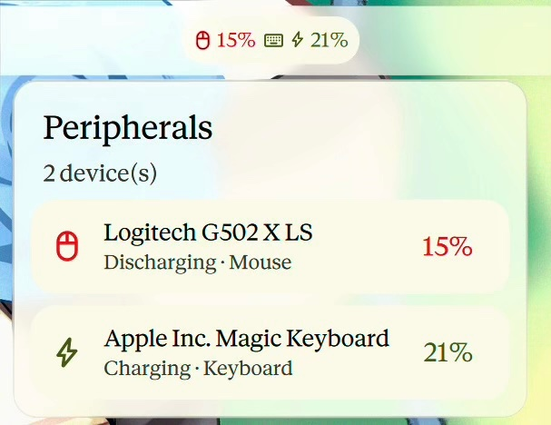

# Peripheral Battery

[English](README.md) | [简体中文](README.zh-CN.md)

A [DankMaterialShell](https://github.com/AvengeMedia/DankMaterialShell) (DMS) bar widget that shows the battery levels of your peripherals — keyboard, mouse, headset, game controller, and more — read directly from UPower.



## Why this exists

DMS's built-in battery service only surfaces peripheral devices while a built-in battery widget is instantiated (its peripheral list stays empty until something holds a reference to it). On a desktop PC without a laptop battery, that widget is never added, so peripheral batteries never show up anywhere.

This plugin reads `UPower.devices` directly instead. No laptop battery, no built-in battery widget, and no helper daemon required — it works on desktops out of the box.

## Features

- Shows every UPower peripheral that reports a battery level: keyboards, mice, touchpads, headphones, headsets, speakers, game controllers, phones, tablets, media players, wearables, and pens
- Per-type icons, charging indicator, and color coding (charging / ≤15% / ≤30%)
- Popout with device name, state, type, and percentage for each device, sorted lowest battery first
- **Only show low battery** mode: hide devices at or above a configurable threshold, so the widget only appears when something actually needs charging
- Optionally hide the widget entirely while no peripheral reports a battery
- Pure QML: no background processes, no shell commands, no network access, no files read or written beyond the plugin's own DMS settings

## Settings

| Setting | Default | Description |
|---|---|---|
| Show percentage | on | Display the numeric battery level next to the icon |
| Hide when no device | on | Hide the widget entirely while no peripheral reports a battery |
| Only show low battery | off | Hide every device whose battery is at or above the threshold |
| Low battery threshold | 50% | Devices at or above this level are hidden while "Only show low battery" is on |

## Requirements

- DankMaterialShell with plugin support
- UPower (already used by DMS itself)
- USB peripherals work out of the box. Bluetooth peripherals only appear once the kernel or BlueZ exposes a battery interface for them — this is a system limitation, not a plugin one

## Installation

Via the DMS plugin registry (once listed):

```sh
dms plugins install peripheralBattery
```

Manually:

```sh
git clone https://github.com/carrotciallo/dms-peripheral-battery ~/.config/dms/plugins/peripheralBattery
```

Then enable **Peripheral Battery** in DMS Settings → Plugins and add it to a bar section in Settings → DankBar Layout.

## Translations

English is the source language (`translations/en.json`). A Simplified Chinese translation ships in `translations/zh_CN.json`. Contributions welcome.

## License

MIT — see [LICENSE](LICENSE).
