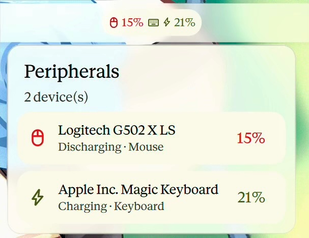

# 外设电量 Peripheral Battery

[English](README.md) | [简体中文](README.zh-CN.md)

一个 [DankMaterialShell](https://github.com/AvengeMedia/DankMaterialShell)（DMS）顶栏插件：直接从 UPower 读取键盘、鼠标、耳麦、游戏手柄等外设的电量并显示。



## 为什么做这个

DMS 内置的电池服务只有在内置电池组件被实例化时才会给出外设列表（没有组件持有引用时该列表恒为空）。台式机没有笔记本电池，永远不会添加那个组件，外设电量也就无处可见。

这个插件改为直接读取 `UPower.devices`：不需要笔记本电池、不需要内置电池组件、不需要任何守护进程，台式机开箱即用。

## 功能

- 显示所有向 UPower 上报电量的外设：键盘、鼠标、触摸板、耳机、耳麦、音箱、游戏手柄、手机、平板、播放器、穿戴设备、触控笔
- 按类型显示图标、充电标记与颜色分级（充电中 / ≤15% / ≤30%）
- 弹出面板列出每台设备的名称、状态、类型与百分比，按电量从低到高排序
- **仅显示低电量**模式：电量达到可调阈值的设备会被隐藏，只有真需要充电时组件才出现
- 可选：没有任何外设上报电量时整体隐藏
- 纯 QML 实现：不拉起后台进程、不执行 shell 命令、不联网、不读写插件自身 DMS 设置以外的任何文件

## 设置

| 设置 | 默认 | 说明 |
|---|---|---|
| 显示百分比 | 开 | 在图标旁显示电量数字 |
| 无设备时隐藏 | 开 | 没有任何外设上报电量时整体隐藏该组件 |
| 仅显示低电量 | 关 | 隐藏所有电量达到或超过下方阈值的设备 |
| 低电量阈值 | 50% | 「仅显示低电量」开启时，电量达到或超过此值的设备将被隐藏 |

## 依赖

- 支持插件系统的 DankMaterialShell
- UPower（DMS 本身也在用）
- USB 外设开箱即用；蓝牙外设只有在内核或 BlueZ 暴露了电量接口之后才会出现，这是系统层面的限制，不是插件的限制

## 安装

经 DMS 插件注册表（上架后）：

```sh
dms plugins install peripheralBattery
```

手动安装：

```sh
git clone https://github.com/carrotciallo/dms-peripheral-battery ~/.config/dms/plugins/peripheralBattery
```

然后在 DMS 设置 → 插件中启用「Peripheral Battery」，并在设置 → DankBar 布局中把它添加到顶栏。

## 翻译

英文为源语言（`translations/en.json`），简体中文翻译在 `translations/zh_CN.json`。欢迎贡献。

## 许可证

MIT，见 [LICENSE](LICENSE)。
